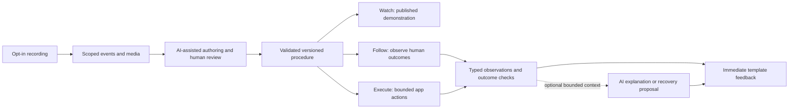

# EguiPilotAI, ViziWiz and PixVix: guided workflow review

**Date:** 2026-11-01  
**Baseline:** main `711fc72`, isolated `review/guided-workflow-standard`.  
**Status:** research and static source review; proposed design, not ratified implementation.  
**Request:** [R297](../requirements.md#r294--2026-11-01).  
**Review plan:** [guided-workflow-standard-review](../plans/guided-workflow-standard-review.md).

## 1. Decision

The requested product is coherent: record an opted-in demonstration, author a
reusable procedure, and use the same procedure to **watch, follow, or execute**.
Normal execution should use typed actions and observed outcomes, with optional
small AI feedback. Its website representation should load without an AI session.

The broad invention is not first-ever. DocWizards (2005) already combined
demonstration learning, guided human execution, automation and illustrated
documentation. AgentRR (2025) closely anticipates reusable checked replay.
Tango and WalkMe combine guidance and automation commercially. Section 5 gives
the primary-source comparison.

The defensible development direction is a **portable, versioned guided-workflow
profile with conformance tests**: one procedure identity and outcome contract
across teaching and automation, native semantic adapters, efficient web
publication, and measured model usage. This review does not establish that the
exact combination is unique.

The existing repo has substantial pieces, but no reviewed end-to-end
record → author → watch/follow/execute product. Fix the capture and Coach
correctness findings before promoting those pieces into that product.

## 2. Evidence and limits

Three independent read-only audits covered native semantics/Coach, capture/
guide publication, and prior art. Root reconciled code paths and current MCP,
A2UI and browser/media documentation. Line references below are relative to
this baseline and can move after edits.

No new application tests, executable screenshots, live recordings, third-party
app actions, or performance benchmarks were run. “Code exists” below means
static implementation evidence, not fresh real-artifact qualification.
Historical proof remains useful but does not qualify arbitrary apps or this new
pipeline. No product code, host recording setting, production endpoint, or
external standard has been changed.

Documentation checks passed: the existing `xtask docs-status` checker reported
21 evidence-backed rows in the canonical harness matrix; this report's JSON
example parses and all six relative document links exist; `git diff --check`
passed. Both source auditors reviewed the report and their corrections were
incorporated. These checks do not replace runtime verification of the findings.

## 3. Current capability map

**PixVix/ViziWiz identity:** the port plan records PixVix's rename to ViziWiz;
the current capture overlay is `crates/viziwiz`, not two independent engines.
Historical platform ring-buffer/P2P specifications are not implementation
evidence for this repo. Normal Steps capture excludes DevPULSE's own PID;
only the drill opt-in includes it (`engine-steps/src/lib.rs:242–261,408–412`).
That must change deliberately for the requested in-app demonstration recorder.

| Area | What the code supplies | What the request still needs |
|---|---|---|
| EguiPilot semantic UI | Typed node/viewport identities, widget metadata, locators, input actions, expectations and settlement; `crates/egui-pilot-ai/src/lib.rs:826,1559`; protocol `:1136,1264`. | Owner instrumentation across relevant controls; semantic coverage and outcome checks, not coordinate replay alone. |
| EguiPilot flows | Authored Action/Coach/Expect/Wait/Capture flows executed through the devtools runtime. | A human demonstration compiler and production lesson controller. `codegen` at CLI `:327` rewrites existing TOML; it is not a recorder. |
| Recording declaration | `Flow.record` exists at protocol `:1278`; runner writes command traces at `runner/src/lib.rs:439,733`. | The flag has no runtime/runner consumer. Existing traces are not consent-aware human capture and can contain supplied text values. |
| Native Coach | Spotlight touchpoints, actor attribution, triggers, and separate state satisfaction; `coach.rs:277,313`. | Watch/follow/execute orchestration, durable lesson progress, correct cross-window predicates, additional qualified visuals. Only Spotlight is accepted by `runtime/src/lib.rs:494`. |
| Foreign apps | Linux fabric/AT-SPI/X11 primitives and CoachHub's one-target lesson path; `crates/hubs/coach/src/lib.rs:261`. | Named-app qualification, reliable recording, complete procedures and OS support matrix. Non-Linux resolve refuses at `crates/coach-runtime/src/lib.rs:267`. |
| ViziWiz steps | Screenshot-oriented recording of left-button presses, Return and manual Mark; `crates/engine-steps/src/lib.rs:300,574`. | Typed text edits, focus/app transitions, semantic identities, causal outcome records, sensitive-field policy and usable variable extraction. |
| Guide output | `crates/guide/src/lib.rs` contains a real HTML exporter and optional video/GIF path. | A shared executable procedure representation, revision-safe editing, delivery budgets and a verified publishing contract. Older “export unbuilt” prose is stale. |
| Workflow infrastructure | Versioned `WorkflowDoc`, registry, validators, schemas, jobs and no-clobber runs; `crates/workflows/src/lib.rs:35,1045,1273,1692`. | Current `StageKind` is media production: outline, slide, image, assemble, render (`:124`). It does not already execute interactive app procedures. Extend the existing doctrine through a planned schema/runtime change. |
| Small observations | AgentSnapshot filtering, changed-since projection, continuation; default 200 nodes/12 KiB, hard 1,000 nodes/64 KiB; protocol `:7,506`. | Cost-qualified event deltas, feedback schemas, cache policy and optional model routing. Existing ceilings are not a recommendation to send 12 KiB every step. |
| Harness viewer/accessibility | Test Lab is explicitly passive (`crates/egui-pilot-ai-lab/src/lib.rs:1`); WidgetInfo exists, AccessKit update detection at pilot `:1099`. | Live lesson execution in Test Lab and full accessibility correlation are not established. Root screenshots do not prove child-window pixels; child capture refuses at runtime `:2330`. |

The native app remains Rust/egui. The existing exporter emits HTML/JavaScript
as an external website artifact; it is not an embedded app webview. A future
web player policy must state that boundary explicitly. No Playwright/Remotion
package manifests were found in this Rust source tree in this audit; this is
not a census of everything installed elsewhere on the operator's computer.

Actual output is a folder containing `guide.json`, media and HTML. The
canonical [ViziWiz architecture](../design/viziwiz-architecture-spec.md)
specifies a `.guide` package and native player; those are not implemented by
this exporter. The older port plan calls HTML a fallback, while the later
demo-guide plan calls the HTML/media output the guide. Resolve this format
authority explicitly; do not silently discard the native-player requirement.
The current browser driver is Rust-owned direct CDP, documented in
[ADR-013](../design/adr-013-browser-driver.md).

## 4. Findings to fix before expansion

**Implementation follow-up, 2026-11-02:** F1 is addressed locally by
[GF1a](../plans/guide-edit-preservation.md), with
[test and executable evidence](../proof/guide-edit-preservation/README.md).
This is a bounded source-guide editor repair; exported/nested guides refuse.
F2 and F7 are now addressed locally by [GF1b](../plans/recorder-stop-save.md):
generation-tagged bounded work, a Stop barrier, source-preserving retryable Save,
exclusive recovery leases and native Stop/Save acknowledgements. The
[evidence](../proof/recorder-stop-save/README.md) records 155 passing affected
tests and an actual disk recovery/publication drill. Live capture, Linux and
pixel qualification remain separate. F3–F6 and F8–F12 remain open. The findings
below retain their original baseline evidence.

### F1 — High: guide editing can delete outside its directory

`crates/engine-steps/src/edit.rs:103–117` validates the *new kept* frame names.
At `:159–161`, deletion uses filenames from the *previous* JSON manifest:
`remove_file(dir.join(orphan))`. A previous entry such as `../outside.webp`,
omitted from the new kept set, reaches that deletion without the same check.
A crafted or corrupt manifest can therefore cause out-of-guide deletion when
edited. This is a static path analysis, not a claim that exploitation occurred.

Normal pruning also deletes original assets and directly overwrites
`guide.json` (`:146–161`), conflicting with the preservation law. The rebuilt
five-field manifest drops additional export/session fields.

**Required correction:** immutable revision writes under a jailed artifact root;
preserve original content and metadata, validate both old and new references,
reject escaping links/reparse points, and publish the revision atomically.
A fixture test should use harmless files entirely inside a temporary test root
and prove that an outside sentinel survives.

### F2 — High: Stop is not a capture barrier

`crates/engine-steps/src/lib.rs:529–541` uses an unbounded trigger worker.
The listener checks `running` before enqueue, but queued items have no session
generation and the consumer does not recheck recording state. Stop at
`:312–334` disables enqueue, leaving the pending session available. A backlog
can capture after Stop or be applied to a later session.

**Required correction:** bounded session-tagged work, cancellation/generation
checks immediately before capture and commit, and a Stop acknowledgement after
in-flight capture is resolved. Test queue pressure, Stop/Save, Stop/Start and
cancellation at each boundary.

### F3 — High: normal CoachHub contains a devtools-only overlay launch

Normal app dependencies and registration include CoachHub
(`crates/app/Cargo.toml:69`, `crates/app/src/main.rs:1343`).
Its lesson path spawns `dpl-coach-overlay` without the required devtools gate
(`crates/hubs/coach/src/lib.rs:326–354`). The
[ratified overlay ADR](../plans/coach-overlay-adr.md) explicitly excludes
normal-production wiring. The Linux Teacher path can also invoke a click
(`:291–304`); do not describe foreign Coach as wholly absent.

**Required correction:** reconcile the actual dependency/launch graph with the
ratified boundary. Any production promotion needs an explicit boundary
amendment and qualification. EguiPilot's own inherited-pipe feature gate remains
separate and should stay devtools-only. This finding does not establish a
running endpoint on the current Windows computer.

### F4 — High: “visible” can mean merely present

`CoachCondition::NodeVisible` tests `find_node(...).is_some()`
(`crates/egui-pilot-ai/src/coach.rs:450`), while hidden/clipped nodes remain in
committed frames (pilot `:850–863,953–966`). A lesson can satisfy while its
target is offscreen. NodeGone similarly tests absence, which must not be
confused with visibility.

**Required correction:** distinguish present, visible, enabled and receives-input;
test clipping, hiding, reappearance and overlap separately.

### F5 — High: an armed mount loses locator constraints

Any resolve error arms a touchpoint at
`crates/egui-pilot-ai-runtime/src/lib.rs:502–505`. The stored mount retains
only node ID and discards viewport and other locator predicates (`:510–528`).
Later lookup is ID-only (`coach.rs:345`). A mismatched viewport/name or hidden
target can become mounted later through that unrestricted path.

**Required correction:** retain the full locator and re-evaluate it; classify
temporary absence separately from invalid, ambiguous or mismatched targets.

### F6 — High for multiwindow lessons: predicate scope follows the highlight

Once bound, the Coach pass skips other viewports (`coach.rs:295–301`), then
evaluates conditions using that viewport's nodes (pilot `:1157–1173`).
A root highlight waiting for a child node to disappear can satisfy while that
child still exists; a child visibility condition cannot satisfy in the root
pass. Independently, a disappearing highlight expires the touchpoint before a
delayed asynchronous outcome can arrive (`coach.rs:345–353`).

**Required correction:** each condition declares its own app/window/lifetime
scope; the outcome waiter outlives visual highlights. Test a menu closing
before save completion, and both directions of root/child conditions.

### F7 — High for durability: failed Save loses the pending handle

`crates/engine-steps/src/lib.rs:338–377` removes the session with `take()`
before fallible rename and manifest write. A failure leaves files but loses the
in-memory retry handle.

**Required correction:** prepare and verify a new destination, retain/recover the
source session until durable commit, and test write denial/disconnection at
each stage. Reconcile rename with the copy/preserve law.
Start also deletes a stopped unfiled session (`engine-steps/src/lib.rs:283–286`);
steps have no durable event journal before the final manifest. Include that
transition and crash recovery in the preservation fix.

### F8 — Medium: attempted input is not demonstrated task success

Runtime actionability checks visibility, disabled state, capability and geometry
samples (`runtime/src/lib.rs:904–932,2084–2112`), but not authoritative hit
reception. Semantic layer values are currently zero (pilot `:877`), and Coach
Press uses rectangle containment (`coach.rs:381–384`). Native action completion
after input/settlement (`runtime/src/lib.rs:1168`) does not prove the intended
application outcome. Expectations retry separately.

**Required correction:** keep attempted, delivered, observed outcome and
completed as different facts. Generated procedures must advance on declared
outcomes; overlapping controls, disabled controls and unrelated events must
not produce false completion.

### F9 — High for recording fidelity: visual sampling can lose the action

Capture samples the focused window when the worker runs, then samples focus
again for the result (`engine-steps/src/lib.rs:431,453`). Those can be different
windows. Equal average image hashes discard both images and the action
(`:455–459`), even though a same-looking interaction can be meaningful.
**Required correction:** retain a timestamped semantic event journal independent
of media compression; bind observations to event/window identity and explicit
state settlement. Image similarity may deduplicate assets, never erase intent.

### F10 — Medium: exported guides are not closed under re-export

Replay steps always require the original supplied session and are recut, even
if the loaded guide already carries its clip (`guide/src/lib.rs:492–503`).
A carried session reference is not copied when no new session is supplied;
HTML generation can then fail on missing media (`:310–318,531–545`).
**Required correction:** round-trip each supported artifact without external
source dependencies; verify every referenced asset before publishing a revision.

### F11 — Medium: small files and equivalent instruction are not yet proven

All stills embed as base64; videos embed by default (`guide/src/lib.rs:123–129,
294–305,392`). The whole payload loads together, preventing independent asset
caching. Replay/clip encoding is limited to 720p/15fps/CRF30 and strips audio
(`engine-media/src/lib.rs:760–815`). The stitched MP4 includes before stills and
clips, but omits instructional captions, click rings and result stills
(`guide/src/lib.rs:514–525,555–567`). It is not an equivalent guide rendering.
**Required correction:** explicit hosted/offline profiles, measured delivery
budgets, quality-aware encoding and a shared instructional composition for
HTML/video export. Keep omitted narration and interaction visibly declared.

### F12 — High for public publishing: capture has no redaction review contract

Screenshots persist window contents/titles; Session records the primary monitor
with selected internal events (`viziwiz/src/session.rs:50–140,195–220`).
The exporter copies/embeds media without a redaction status. Absence of typed
keystroke recording does not protect secrets visible in media. The existing
demo-guide plan already identifies this gap.
**Required correction:** scoped capture, sensitive-region handling, a reviewable
public derivative and explicit publish readiness. Preserve the private source;
do not automatically send raw recordings to model training or website delivery.

Historical DG1 proof does not close these gaps: the mixed-export drill at
`crates/guide/tests/mixed_export_drill.rs:34` is ignored by default and tests
DOM/file properties, not decoded playback quality, accessibility or load budgets.

## 5. Prior art: what is already established

Dates identify the cited paper or documented release, not a universal priority
claim. These are primary research papers and official product sources.

| Source | Direct overlap | Limit of the cited evidence |
|---|---|---|
| [DocWizards, UIST 2005](https://research.ibm.com/publications/docwizards-a-system-for-authoring-follow-me-documentation-wizards), [paper](https://courses.cs.washington.edu/courses/cse590h/05au/papers/DocWizards-UIST2005.pdf) | Demonstrations become editable procedures; user-following guidance, individual/full automation and illustrated HTML documentation. | Instrumented Eclipse/SWT prototype, not a universal modern cross-app protocol. |
| [Koala, CHI 2007](https://people.csail.mit.edu/glittle/Papers/Koala%20CHI%202007.pdf), [CoScripter](https://research.ibm.com/publications/coscripter-automating-andamp-sharing-how-to-knowledge-in-the-enterprise) | Browser recording into readable executable instructions, sharing and personalizing procedures. | Browser interpreter; readable scripts do not establish a portable three-mode outcome contract. |
| [PLOW, AAAI 2007](https://cs.rochester.edu/research/cisd/pubs/2007/allen-et-al-plow-aaai2007.pdf) | Demonstrations plus explanations/clarification teach parameterized tasks, branches and loops. | Does not establish the proposed hosted guide format. |
| [Pause-and-Play, UIST 2011](https://www.juew.org/publication/uist11.pdf) | Synchronizes screencast progress with actual learner activity. | Adaptive tutorial playback, not a general executable workflow compiler. |
| [SUGILITE, CHI 2017](https://www.cs.cmu.edu/~NatProg/sugilite.html) | Accessibility-grounded demonstrations and natural language produce reusable cross-app automation. | Android-focused; no equivalent portable watch/follow/execute publishing contract established here. |
| [Power Automate recorder](https://learn.microsoft.com/en-us/power-automate/desktop-flows/recording-flow), [UiPath XAML export](https://docs.uipath.com/task-capture/standalone/2022.4/user-guide/export-uipath-studio) | Desktop/browser recording becomes flow actions; process capture can export robot prototypes. | Recorders need editing; conditionals/loops and a complete runnable robot are not automatically inferred in those features. |
| [Tango Guidance, May 24 2023](https://updates.tango.ai/announcements/guidance-is-here), [AI CRM Admin, April 16 2025](https://updates.tango.ai/announcements/introducing-tango-s-ai-crm-admin) | Captured workflow guidance; users choose automated versus manually completed steps. | An externally portable shared procedure representation is not established. |
| [WalkMe, July 10 2017](https://support.walkme.com/knowledge-base/release-notes-july-17/) | Guided flows already include branches, error handling and automated steps. | Does not establish AI compilation of demonstrations into the proposed open format. |
| [SkillWeaver, April 9 2025](https://arxiv.org/abs/2504.07079) | Agents synthesize, test and reuse executable browser skills based on Playwright. | Agent-generated skills; not the complete human teaching/publishing pipeline. |
| [AgentRR, May 23 2025](https://arxiv.org/abs/2505.17716) | Record, summarize reusable experience, replay with check functions; includes human demonstrations. | Framework proposal; some checks/adaptation may use models. No proof of universal deterministic execution or the proposed guide package. |

The search establishes strong overlap, not exhaustive absence. “We did not find
the exact intersection” cannot support “we are first.” A credible public claim
would describe the implemented interoperability and measured results rather than
priority over the broad concept.

## 6. Proposed product and execution contract

### One procedure, three modes



- **Watch:** play a published demonstration without touching a live app. Also
  offer **live AI demonstration** explicitly: Execute's authorized actions and
  outcome checks, with visible pacing, explanation and pause/stop. The person
  can watch the AI use the actual application; label live effects clearly and
  prefer practice data for teaching. This option must use a qualified adapter,
  not be confused with passive website playback.
- **Follow:** highlight the next target, let the person act, and advance only on
  observed completion. Allow pause, recap, practice, manual acknowledgement
  where observation is unavailable, and clear labeling of that weaker evidence.
- **Execute:** invoke authorized typed capabilities and check the same outcomes.
  Pause on drift or ambiguity. A recorded demonstration does not confer blanket
  permission to repeat its external effects.

The literal mouse/keyboard trace is evidence. It does not identify intent,
parameters, loops, or what proves success. Initially, “training” should mean
using that evidence to author a reviewed procedure; it need not mean changing
model weights. Keep any later training-data use a separate explicit operation.

The portable language should be a typed intermediate representation (IR),
compiled into validated runtime operations. Actual CPU machine code is not
needed per recording. Rust enums and a deterministic executor can provide the
cheap fast path while preserving portability and inspectability.

### Required semantics

The proposed profile must define:

1. Procedure ID/version, schema version, content digest, source demonstration
   references, author/review provenance and compatibility requirements.
2. Typed parameters and explicit sensitive-value references. Passwords and
   tokens never become saved reusable plaintext demonstrations.
3. App capabilities and stable semantic target identities with app, instance
   and viewport scope; adapters declare what they can observe and invoke.
4. Preconditions, action, expected outcome, timeout, cancellation and bounded
   retry policy. Retry only when idempotency/deduplication is defined.
5. Causal evidence: actor (person/agent/app), sequence, monotonic time, run/step/
   attempt IDs, before/after state and observation freshness.
6. Explicit unsupported/ambiguous/timeout outcomes; resumable checkpoints must
   revalidate current state and never blindly repeat a completed side effect.
7. A presentation track: captions, cursor path, focus region, media references,
   accessible text and timing, linked to the same step identities.
8. A bounded feedback contract. Model-written prose cannot change actions,
   permissions, completion status or trusted observed values.

Illustrative shape only, **not a shipped schema, API or registered node ID**:

```json
{
  "profile": "guided-workflow-draft",
  "version": 1,
  "id": "example.create-local-note",
  "requires": [{"adapter": "example.notes", "version": "1"}],
  "parameters": {"title": {"type": "string", "sensitive": false}},
  "steps": [{
    "id": "enter-title",
    "target": {"app": "example.notes", "window": "editor", "node": "note.title"},
    "precondition": {"kind": "editable"},
    "action": {"kind": "set-value", "parameter": "title"},
    "outcome": {
      "scope": {"app": "example.notes", "window": "editor"},
      "kind": "value-equals-parameter",
      "node": "note.title",
      "parameter": "title"
    },
    "timeout_ms": 3000,
    "retry": {"max_attempts": 1},
    "presentation": {"caption": "Give the note a title.", "media_ref": "step-1"},
    "feedback": {"template": "step-result", "optional_ai_text": true}
  }]
}
```

This sketch must be reconciled with the existing
[workflow doctrine](../design/workflow-doctrine.md), stage census, schemas,
registry and jobs facts. It is not permission to introduce a competing engine.
A separate modular owner for interaction types may be appropriate; ownership
and integration must be explicit in the implementation plan.

### Scope of recording

Start with named, opted-in apps/windows and a visible pause/stop indicator.
Capture semantic text edits as values/parameters where permitted, instead of
assuming every raw keystroke is useful. Redact sensitive controls before
persistence and model submission; unobservable sensitive content requires
capture exclusion or manual review, not an unsupported promise.

Adapters should advertise independent capture, observe, guide and execute
capabilities. Native app instrumentation is strongest; accessibility/browser
adapters cover other named apps; image-only capture can still publish watchable
guides but cannot claim verified execution. Linux/X11, Wayland, Windows and
macOS must be separately qualified. Universal “every app” support is not a
valid default claim.

## 7. How this fits MCP, A2UI and existing tooling

Versions were checked on 2026-11-01; pin specific revisions in implementation.

| Layer | Existing contract | Proposed use |
|---|---|---|
| MCP core | Current latest redirects to [2026-07-28](https://modelcontextprotocol.io/specification/2026-07-28). Tools/resources, capability negotiation and request semantics already exist. | Expose procedure discovery/validation and bounded run operations through a namespaced adapter. Pin the chosen revision rather than mixing older session setup with current request metadata. |
| MCP Tasks | [Tasks extension](https://modelcontextprotocol.io/extensions/tasks/overview) supplies durable task handles, progress, input-required and cancellation for long-running tools. | Map the existing run/job identity to Tasks instead of inventing another transport lifecycle. Outcome semantics remain in the procedure contract. |
| MCP Skills | [Skills extension](https://modelcontextprotocol.io/extensions/skills/overview) provides discovery and retrieval of instructions/resources; [WG charter](https://modelcontextprotocol.io/community/working-groups/skills-over-mcp) says SEP-2640 is Final. | Package authoring instructions and procedure resources with existing discovery. A retrieved skill is not inherently a validated executable procedure or automatically activated permission. |
| A2UI | [v0.9.1 current; v1.0 candidate](https://a2ui.org/). Trusted catalogs render declarative components natively. | Coach cards, progress, choices, explanations and outcome data. A2UI describes UI; the workflow runtime owns execution truth. Do not label v1.0 stable. |
| A2UI over MCP | [Official guide](https://a2ui.org/guides/a2ui_over_mcp/) already separates cached presentation resources from dynamic tool data. | Reuse templates and send small data updates. Binding examples vary with MCP revision; reconcile and test against the pinned protocol. |
| MCP Apps | [Current overview](https://apps.extensions.modelcontextprotocol.io/api/documents/overview.html) uses sandboxed HTML iframe views with tool calls and context updates. | Optional external-host presentation. It does not fit an embedded native app webview under current repo law; a native A2UI renderer is a different binding. |
| AG-UI | [Event-based agent/frontend protocol](https://docs.ag-ui.com/introduction). | Optional external integration for run state and feedback; do not create a network/IPC boundary inside the Rust application merely to use it. |
| Playwright | [Codegen](https://playwright.dev/docs/codegen-intro) records browser actions and explicit assertions using locators. | Browser adapter and conformance/testing reference. It does not record arbitrary native apps. |
| Remotion | [Player](https://www.remotion.dev/docs/player) embeds parameterized compositions in React applications. | Motion/presentation reference or separately approved export adapter. It is not a semantic app automation protocol, and is not a required dependency for efficient guides. |
| rrweb | [Project](https://github.com/rrweb-io/rrweb) records/replays web sessions. | Useful web-replay reference; replaying a captured page representation is not proof of completing a task in a live application. |

A2UI's [October 27 update](https://developers.googleblog.com/fast-reliable-a2ui/)
is especially relevant: it separates inference syntax from JSON transport,
offers compact Express compilation, and describes controlled layouts with
model-generated text. Compact UI syntax alone is therefore not a new
differentiator. Their reported benchmark gains do not establish our cost or
latency.

Keep the protocol vocabulary independent from any particular model. MCP carries
capabilities and runs; A2UI carries approved presentation; the proposed profile
carries the otherwise missing common procedure/outcome/teaching semantics.
A conforming implementation must prove the relationship, not merely emit JSON.

## 8. Cheap execution and fast hosted guides

### Runtime cost

For a known validated procedure, target **zero LLM calls on the normal path**.
The runtime evaluates state and executes actions. Templates can immediately say
“Saved” or explain a typed validation error. Optional AI sees only the current
step, relevant facts and a bounded question—not the entire screenshot history.

Use AI for authoring, questions, new circumstances or an explanation where it
adds value. Fixed component layouts and data updates avoid regenerating UI.
Enforce input/output budgets, cache safe repeated explanations and fall back to
templates on timeout. Never let an eloquent model response mark a failed step
as successful.

Measure authoring separately from reuse:

`cost per run = authoring cost / reuse count + execution cost + optional feedback + recovery + delivery`.

Execution, storage and bandwidth still cost resources. “Deterministic” means
the executor follows the declared policy under observed inputs; external apps
can change or fail.

### Website output

Keep one canonical procedure with a derived public presentation manifest.
Publishing strips private trace values and execution credentials while retaining
step IDs, captions, timings and media provenance. Preserve the private original.

Offer a compact hosted form: cacheable player, manifest and content-addressed
assets; load the first step first and fetch subsequent assets as needed.
Deduplicate stills; animate cursor/focus/callouts; reserve video for motion that
actually teaches something. Keep an offline self-contained export as a separate
delivery profile—embedding every image as base64 trades cacheability and initial
payload for portability.

The viewer needs keyboard controls, pause/speed/seek, captions/transcript,
reduced motion, readable zoom, responsive framing and clear manual progress.
These make guides friendly without requiring a model at viewing time.
Live Follow/Execute needs a qualified local/app adapter; an ordinary hosted
page cannot observe arbitrary desktop state on its own.

Proposed budgets, **not measured results**:

| Gate | Proposed acceptance |
|---|---|
| Normal procedure run | Zero model calls after authoring with feedback disabled. |
| Feedback | Enforced maximum context/output size; report actual calls, tokens, cost and fallback rate. |
| Initial hosted transfer | Start with a target of ≤200 KiB compressed player + initial manifest, excluding lazily loaded media; revise only from a documented benchmark. |
| First usable step | Measure p50/p95 on a declared midrange device and network; initial target p95 <1 s with a small first asset. |
| Outcome precision | No false advancement in the controlled negative cases: wrong window, hidden/overlapped control, stale state, duplicate event and delayed completion. |
| Capture stop | No post-stop capture commits; no cross-session queue contamination. |
| Recovery | Restart/disconnect/cancel tests preserve sources and avoid duplicate side effects. |
| Portability | Same procedure identity drives all three modes in at least two independent app adapters. |

## 9. Delivery order and standards path

1. **Correctness and preservation:** address F1–F12 with focused fault tests;
   reconcile overlay gating and guide-format truth. No protocol marketing before
   the existing behavior is dependable.
2. **One native vertical slice:** one non-destructive in-repo task, opted-in
   semantic capture, reviewed parameters/outcomes, one procedure, watch/follow/
   execute, pause/resume and no-model normal execution. Prove the real exe.
3. **Publishing slice:** derive an optimized guide from that same artifact,
   measure payload/accessibility/load behavior and retain immutable revisions.
4. **Second adapter:** a named browser workflow using Playwright concepts, plus
   a separately qualified foreign-app target afterward. This tests whether the
   contract is portable rather than encoding egui assumptions.
5. **Interoperability draft:** schema, normative execution semantics,
   capability negotiation, failure examples, security boundaries, test vectors
   and reference Rust implementation. Namespaced MCP profile and A2UI catalog;
   no blanket app/OS support claim.
6. **External standardization:** compare the demonstrated gaps with existing
   MCP Skills/Tasks and A2UI work, then discuss with their maintainers. MCP's
   [SEP process](https://modelcontextprotocol.io/community/sep-guidelines)
   requires prior community discussion before a proposal PR. This is a future
   authorized activity, not something performed by this review.

Immediate next implementation scope should be the correctness/preservation cut.
The architecture proposal needs decisions on production Coach boundaries,
canonical guide representation and adapter qualification; it does not require
inventing a new transport or compact UI syntax first.

## 10. Product clarification — 2026-11-02

R298 makes the authoring experience explicit: guided UI handles recording,
feeding evidence, generation, testing and publication; advanced/devtools UI
exposes complexity progressively over the same artifact. The focused
[scripted UI events brief](scripted-ui-events-brief.md) separates the standards
research scope for A2UI-triggered commands, verified domain signals and small
feedback updates, grounded in existing signal doctrine and event standards.

